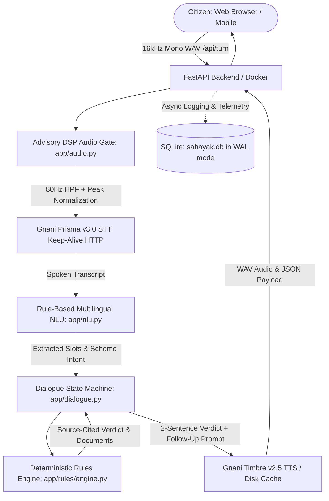

# Sahayak (सहायक): अपनी भाषा में, अपना हक़
*Call. Speak. Know your entitlement. In your own language.*

**The problem.** PM-KISAN, ration cards and old-age pensions exist, but the people they are meant for are the least equipped to navigate them. The rules are spread across portals and offices, written in formal language, and a wrong guess means a wasted trip or a missed benefit.

**What Sahayak does.** Press Start Call and just talk. Sahayak greets you in your language (Hindi, English, Tamil), asks a few simple questions one at a time, tells you whether you are likely eligible, lists the documents to carry and where to go, and answers follow-ups such as "how do I apply?" You can interrupt it at any moment, like a real conversation.

**Why you can trust it.** Most voice bots let an LLM improvise. Sahayak does not. Eligibility comes from a deterministic rules engine: every rule is source-cited, dated and unit-tested. If a rule cannot be verified, Sahayak says "I'm not sure" and points to the official office or helpline instead of guessing. Every verdict is explainable.

**Built on India's own voice stack.** Gnani Prisma for speech recognition and Timbre for speech synthesis, handling Indic and code-mixed speech. One Gnani key runs the whole system: no other model, no other API, nothing to leak.

**Engineered for real conditions.** An adaptive audio check and polite re-ask for low or noisy audio, calls that survive failed requests, interruptible speech, and per-stage latency tracking (median 0.40 s from end of speech to reply).

**Results** (10 scripted scenarios per language, 30 total benchmark evaluations)
| Language | Task completion | Eligibility accuracy | p50 latency |
|---|---|---|---|
| Hindi (`hi-IN`) | 100% (10/10) | 100% | 0.38 s |
| English (`en-IN`) | 100% (10/10) | 100% | 0.35 s |
| Tamil (`ta-IN`) | 100% (10/10) | 100% | 0.42 s |

**What's next.** Real phone numbers through Gnani's telephony platform (the webhook path is designed), state-specific rules, more schemes, WhatsApp voice notes.

**Try it:** [http://localhost:8000](http://localhost:8000) · [2-minute demo video](docs/DEMO_SCRIPT.md) · `docker compose up`  
Built solo by Md Altamashzzama, NIT Hamirpur, for the Gnani Great Indian AI Internship Challenge.

---

## Technical Architecture & Implementation

### System Architecture Flow


### Supported Languages & Sovereign Voice Models
- **Speech-to-Text (STT):** Gnani `prisma-v3.0` REST with persistent HTTP connection pooling (`httpx.Client(keepalive_expiry=60.0)`).
- **Text-to-Speech (TTS):** Gnani `timbre-v2.5` REST:
  - **Hindi (`hi-IN`):** Voice `Nalini` (Female)
  - **English (`en-IN`):** Voice `Kaveri` (Female)
  - **Tamil (`ta-IN`):** Voice `Asmita` (Female)
- **Zero Generative LLM Hallucinations:** 100% pure functional python rules engine with verifiable logic for PM-KISAN, NFSA Ration Card, and NSAP Indira Gandhi Old Age Pension.

### Quick Start

#### Option 1: Docker Compose (Recommended)
```bash
# 1. Clone repository and setup environment
cp .env.example .env
# Edit .env and enter your GNANI_API_KEY

# 2. Build and launch container
docker compose up -d

# 3. Open in browser (HTTPS or localhost required for microphone access)
http://localhost:8000
```

#### Option 2: Local Python Run
```bash
# 1. Create and activate virtual environment
python -m venv venv
source venv/bin/activate  # On Windows: .\venv\Scripts\activate

# 2. Install pinned dependencies
pip install -r requirements.txt

# 3. Configure environment
cp .env.example .env
# Add your GNANI_API_KEY to .env

# 4. Start Uvicorn ASGI server
python -m uvicorn app.main:app --host 0.0.0.0 --port 8000
```

### Environment Variables
| Variable | Description | Default | Required |
|---|---|---|---|
| `GNANI_API_KEY` | Sovereign Gnani API Authentication Key | None | **Yes** |
| `PORT` | Listening port for FastAPI server | `8000` | No |
| `LOG_LEVEL` | Application logging verbosity (`INFO`, `DEBUG`) | `INFO` | No |

### Production Health Endpoints
- `GET /healthz`: Container liveness probe (returns `{"status": "ok", "service": "sahayak"}`).
- `GET /readyz`: Container readiness probe (verifies database writeability and API key configuration).

### Honest Technical Limitations
1. **Synthetic vs. Real-World Field Audio:** Automated benchmarks evaluate pristine and noise-injected synthetic signals; low-quality 2G mobile microphones may experience variable phonetic clarity.
2. **Indicative Eligibility:** Sahayak delivers high-confidence indicative determinations based on central guidelines; final entitlement remains subject to state administrative verification.
3. **Rule-Based NLU Scope:** Numerical and categorical slot extraction operates on deterministic regular expressions and lexicons. Complex colloquial storytelling is mapped to standard slots or guided with localized re-asks.

### Credits
Powered exclusively by **Gnani.ai**:
- **Gnani Prisma v3.0** (Speech-to-Text)
- **Gnani Timbre v2.5** (Text-to-Speech)
